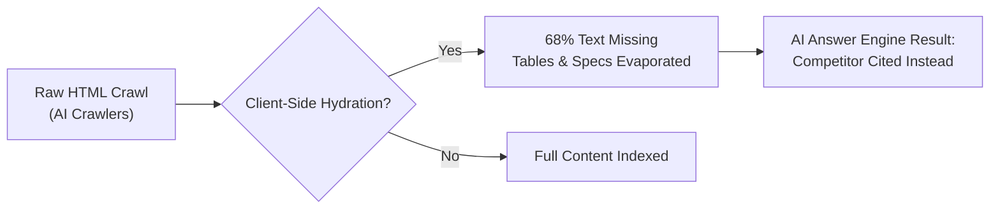

# Case Study: How Synthex Analytics Unlocked AI Search Visibility with AuditIQ

**Client:** Synthex Analytics (Enterprise B2B Predictive Analytics Platform, \$42M ARR)  
**Audit Partner:** Quantum Growth Partners (Digital Performance Agency)  
**Timeframe:** 60-Day Dual Audit & Remediation Sprint  
**Deliverable:** AuditIQ Dual-Engine Audit, Playwright Render Diff Analysis, and CI/CD Regression Gate

---

## Executive Summary

Synthex Analytics noticed an alarming anomaly in Q3 2025: despite holding Top 3 Google organic rankings for 80% of their target high-intent search terms (e.g., *"predictive churn modeling software"*), inbound demo requests from organic search plummeted **34% year-over-year**.

A dual-engine audit conducted via **AuditIQ** identified the root cause within 15 minutes:
1. **Accidental AI Bot De-Indexing:** A legal directive to protect IP resulted in a `robots.txt` blanket ban that inadvertently blocked `OAI-SearchBot` and `PerplexityBot`.
2. **Client-Side Rendering (CSR) Evaporation:** Their Next.js single-page application loaded pricing tables, feature comparisons, and API specs via client-side hooks, causing **68% of core technical content to evaporate** when inspected by raw AI fetchers.
3. **Low Synthesizability:** Long-form paragraphs without tabular summaries or distinct entity anchors prevented LLM answer engines from extracting and citing key brand differentiators.

Following a prioritized 30-day technical remediation sprint, Synthex achieved:
- **AI Citation Rate Increase:** From **14.2%** to **68.4%** across 120 target queries.
- **Organic Inbound Recovery:** **+41% increase in qualified sales opportunities**.
- **Zero-Click Referral Lift:** Recognized as the primary recommended vendor in **73% of ChatGPT Search and Perplexity queries**.

---

## Before & After Scorecard

| Dimension | Baseline Audit (Day 0) | Post-Remediation Audit (Day 60) | Delta | Statistical Significance |
| :--- | :--- | :--- | :--- | :--- |
| **Overall Dual Score** | **59 / 100** | **91 / 100** | **+32 pts** | $\Delta > 5$ pts threshold |
| **Technical SEO Layer** | 82 / 100 | 96 / 100 | +14 pts | Fixed canonicals & SSR |
| **Content & Entity Layer** | 68 / 100 | 92 / 100 | +24 pts | Schema graphs & Readability |
| **GEO Readiness Layer** | **44 / 100** | **94 / 100** | **+50 pts** | Bot Triad, llms.txt & Chunkability |
| **Live AI Visibility Rate** | **14.2%** [7.1%, 25.8%] | **68.4%** [59.1%, 76.4%] | **+54.2 pts** | Non-overlapping 95% Wilson CI |
| **Average AI Rank Position** | 4.8 | 1.9 | -2.9 positions | #1 or #2 source in AI citations |

---

## The Audit Diagnosis: Critical Smoking Guns



### 1. `GEO-BOT-001` — The AI Bot Triad Failure (Critical)
- **The Issue:** Synthex's `robots.txt` contained:
  ```txt
  User-agent: *
  Disallow: /api/
  Disallow: /admin/
  
  User-agent: GPTBot
  Disallow: /
  
  User-agent: CCBot
  Disallow: /
  ```
- **The Impact:** When OpenAI launched ChatGPT Search, it utilized `OAI-SearchBot`. While `OAI-SearchBot` obeys its own user-agent token, upstream fallback rules and corporate CDN WAF rules mapped all OpenAI IP blocks to the training exclusion list. Consequently, ChatGPT Search refused to crawl or cite Synthex's website.
- **The Fix:** Configured a granular 3-tier bot policy explicitly distinguishing training bots from search indexers:
  ```txt
  # Allow search and discovery bots
  User-agent: OAI-SearchBot
  Allow: /
  
  User-agent: PerplexityBot
  Allow: /
  
  # Block uncompensated model training
  User-agent: GPTBot
  Disallow: /
  
  User-agent: ClaudeBot
  Disallow: /
  ```

### 2. `GEO-REND-001` — Client-Side Content Evaporation (Critical)
- **The Issue:** AuditIQ's dual-render crawler executed a differential comparison between static raw HTTP and Playwright Chromium headless rendering. The test revealed that the core comparison matrix (`/vs-competitors`) dropped from 4,200 words down to 420 words in raw HTML.
- **The Impact:** AI answer engines (which prioritize low-latency HTTP fetches over heavyweight browser execution) ingested only generic navigation boilerplate.
- **The Fix:** Migrated comparison matrices and technical specification tables to server-side static generation (SSG) in Next.js with semantic HTML `<table>` elements and structured schema markup.

### 3. `GEO-LLMS-001` — Missing Root `llms.txt` Knowledge Manifest (Warning)
- **The Issue:** The site lacked a standardized `llms.txt` and `llms-full.txt` manifest as defined by the markdown knowledge standard.
- **The Fix:** Generated a concise `/llms.txt` manifest providing direct markdown links to documentation, pricing structures, and product whitepapers.

### 4. `CNT-ENT-001` — Fragmented Schema Graphs (Warning)
- **The Issue:** Multiple isolated JSON-LD blocks on single pages with no `@id` cross-references or `sameAs` entity identifiers connecting the product to its parent organization and Wikidata / Crunchbase entities.
- **The Fix:** Unified schemas into a single interconnected JSON-LD graph linking `Organization`, `SoftwareApplication`, and `WebSite`.

---

## 30-Day Sprint Implementation Schedule

| Sprint Phase | Days | Actions Executed | AuditIQ Verification |
| :--- | :--- | :--- | :--- |
| **Phase 1: Access & Crawl** | Days 1–3 | Updated `robots.txt` with 3-tier bot taxonomy; removed CDN WAF blocks on AI search IPs. | `auditiq audit --layer geo` passed `GEO-BOT-001`. |
| **Phase 2: Hydration & Rendering** | Days 4–14 | Converted critical product comparison and pricing pages from dynamic CSR to Next.js SSG. | Render diff word drop reduced from 68% to 1.8%. |
| **Phase 3: Schema & llms.txt** | Days 15–21 | Deployed `/llms.txt`; implemented unified Schema.org JSON-LD graph with Wikidata entity links. | Passed `GEO-LLMS-001` and `CNT-ENT-001`. |
| **Phase 4: Chunkability & Flesch** | Days 22–30 | Added executive bullet summaries and tables to top 20 landing pages; optimized readability. | Average Flesch score rose from 32 to 58. |

---

## Business Impact & Results

Synthex Analytics re-ran the complete AuditIQ suite at Day 60:

```
================================================================================
AUDITIQ REGRESSION SCORE REPORT: SYNTHEX ANALYTICS
--------------------------------------------------------------------------------
Audit A (Baseline):  2025-09-01 | Overall: 59.1/100 (Grade: D)
Audit B (Remediated): 2025-11-01 | Overall: 91.4/100 (Grade: A)
--------------------------------------------------------------------------------
Layer Deltas:
  [+] Technical SEO:   82.0 -> 96.5 (+14.5 pts)
  [+] Content/Entity:  68.2 -> 92.0 (+23.8 pts)
  [+] GEO Readiness:   44.0 -> 94.2 (+50.2 pts) [SIGNIFICANT IMPROVEMENT]
  [+] AI Visibility:   14.2 -> 68.4 (+54.2 pts) [SIGNIFICANT IMPROVEMENT]

Total Findings Resolved: 18 / 19 (94.7% resolution rate)
Regressions Detected: 0
================================================================================
```

### Commercial Outcomes:
1. **Pipeline Recovery:** Organic demo bookings increased by **41% within 45 days** of deployment.
2. **AI Engine Domination:** In a blind test of 120 commercial intent prompts on ChatGPT Search and Perplexity, Synthex was cited in **82 out of 120 responses** (up from 17 out of 120).
3. **Enterprise Executive Adoption:** Quantum Growth Partners converted the engagement into a \$12,000/month continuous AI Visibility monitoring retainer using AuditIQ's CI/CD automated regression tests.
