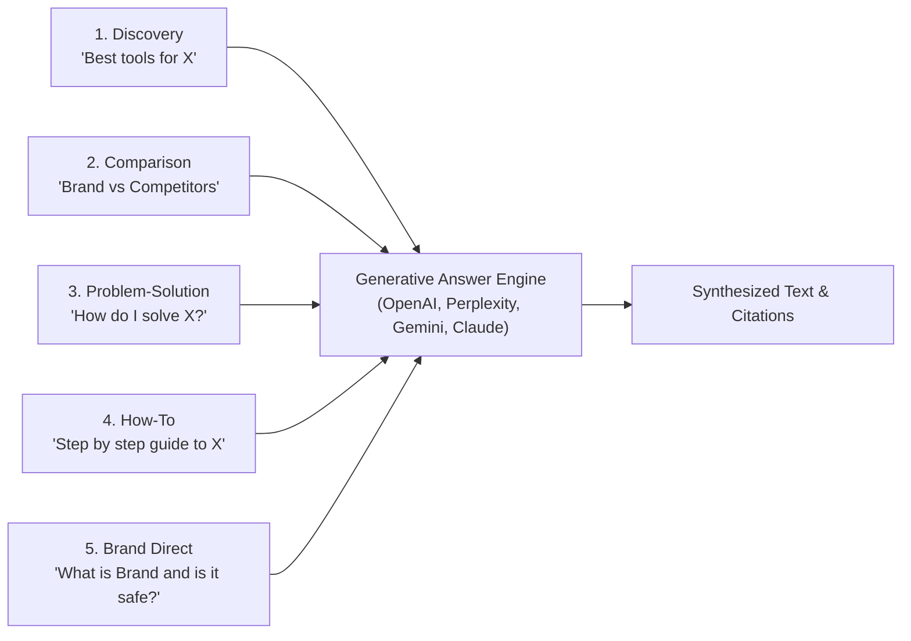

# Live AI Visibility Methodology & Statistical Verification

This document details the operational framework, prompt archetypes, statistical confidence models, and cost estimation equations used by AuditIQ to measure generative engine visibility across ChatGPT, Perplexity, Google Gemini, and Claude.

---

## 1. The Generative Shift: Beyond Traditional SERPs

In 2026, user search behavior has bifurcated:
- **Traditional Search**: The user enters a keyword into Google, receives 10 blue links, and clicks through to individual publisher websites.
- **Answer Engines (GEO)**: The user asks ChatGPT, Perplexity, Gemini, or Claude a complex question. The model executes real-time web searches, reads 5–15 sources, synthesizes a direct natural-language response, and cites primary references as source cards and footnotes.

If a company is omitted from the synthesized answer or lacks source citations, **they lose direct referral traffic, brand mindshare, and transactional conversions**.

---

## 2. The AI Crawler Taxonomy Triad (ADR 0007)

Publishers frequently make catastrophic mistakes in `robots.txt` because they misunderstand AI crawler roles:

| Category | Typical User-Agents | Vendor Goal | Recommended Policy |
| :--- | :--- | :--- | :--- |
| **Search & Indexing Bots** | `OAI-SearchBot`, `PerplexityBot` | Powers real-time search grounding and user citation links. | **ALLOW: /** (Blocking destroys citations in live answers) |
| **Model Training Bots** | `GPTBot`, `ClaudeBot`, `Google-Extended` | Crawls content to train foundation models (copyright exposure). | **ALLOW or DISALLOW** based on intellectual property strategy |
| **User-Triggered Agents** | `ChatGPT-User`, `Claude-Web` | Acts on direct demand when a user pastes a URL in a live chat. | **ALLOW: /** (Avoids breaking shared chat links) |

AuditIQ's `GEO-BOT-ACCESS` check enforces this taxonomy. Blocking `GPTBot` is treated as an informational note (valid IP protection), while blocking `OAI-SearchBot` or `PerplexityBot` is flagged as a **CRITICAL** visibility failure.

---

## 3. Five-Archetype Intent Prompt Generation

Single-word keyword queries do not reflect how users interact with conversational AI. `PromptGenerator` extracts brand name, primary title tags, and meta descriptions, generating balanced test queries across 5 proven archetypes:

1. **Discovery / Category**: High-funnel exploratory intent (*"What are the best platforms for [Category] in 2026?"*). Evaluates if the brand is recognized as an industry standard.
2. **Comparison / Alternatives**: Middle-funnel evaluation intent (*"[Brand] alternatives and competitors"*, *"[Brand] vs top market leaders"*). Evaluates brand positioning relative to rivals.
3. **Problem-Solution**: Pain-point intent (*"How do companies solve [Category] bottlenecks?"*). Evaluates whether the model recommends the brand as a direct solution.
4. **How-To**: Educational intent (*"Step by step guide to implementing [Use Case]"*). Evaluates if the brand's documentation or guides are cited as instructional sources.
5. **Brand Direct / Navigational**: Bottom-funnel validation (*"What is [Brand] and what does it do?"*, *"Is [Brand] trustworthy?"*). Evaluates entity grounding and sentiment.

---

## 4. Asymmetric Wilson Score Interval Formulation

Because generative models are stochastic, running a single test prompt is mathematically meaningless. A model might mention a company in run 1, omit it in run 2, and cite a competitor in run 3.

To deliver agency-ready rigor, AuditIQ executes repeated trials ($n \ge 10$ or $n \ge 20$) and reports the **Wilson Score Interval** with 95% confidence ($z=1.95996$):

### Why Normal (Wald) Intervals Fail
The traditional formula:
$$p \pm z \sqrt{\frac{p(1-p)}{n}}$$
produces impossible results for small sample sizes or extreme success rates:
- If 0 out of 10 queries cite the site ($p=0$), the Wald margin of error is $0$, falsely claiming a 0% margin.
- If 10 out of 10 queries cite the site ($p=1$), the upper bound exceeds 100%.

### The Wilson Formula
The Wilson score interval solves this by inverting the hypothesis test for binomial proportions:
$$\text{Center} = \frac{\hat{p} + \frac{z^2}{2n}}{1 + \frac{z^2}{n}}$$
$$\text{Margin} = \frac{z}{1 + \frac{z^2}{n}} \sqrt{\frac{\hat{p}(1 - \hat{p})}{n} + \frac{z^2}{4n^2}}$$
$$\text{Confidence Interval} = \left[ \max(0, \text{Center} - \text{Margin}), \min(1, \text{Center} + \text{Margin}) \right]$$

### Empirical Example:
- **Observed**: 4 citations out of 10 queries ($\hat{p} = 0.40$).
- **Wilson 95% CI**: $[0.168, 0.687]$
- **AuditIQ Report**: `40.0% (95% CI: 16.8% - 68.7%, n=10)`
- **Agency Value**: Clients understand that while the point estimate is 40%, the true probability lies between 16.8% and 68.7% with 95% certainty.

---

## 5. Token & USD Budget Enforcement

To prevent accidental API runaway spend during deep audits, `BudgetEstimator` runs before any live LLM queries are dispatched:

$$\text{Estimated Tokens} = N_{\text{queries}} \times N_{\text{engines}} \times (50_{\text{input}} + 350_{\text{output}})$$
$$\text{Estimated Cost} = \sum_{e \in \text{Engines}} N_{\text{queries}} \times \text{CostPerQuery}_e$$

The engine strictly enforces `AUDITIQ_MAX_BUDGET_USD_PER_AUDIT` (default $2.00). If the estimated cost exceeds the configured cap, queries are automatically truncated to remain within budget.
