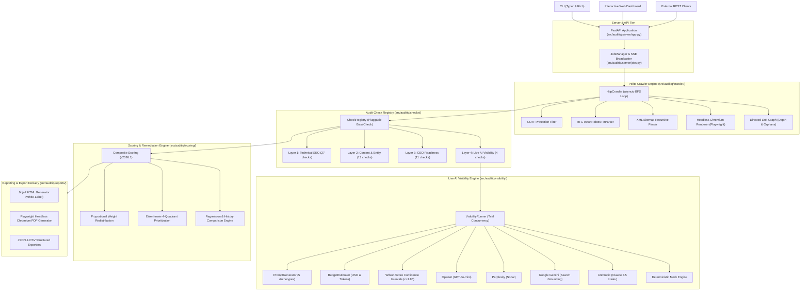
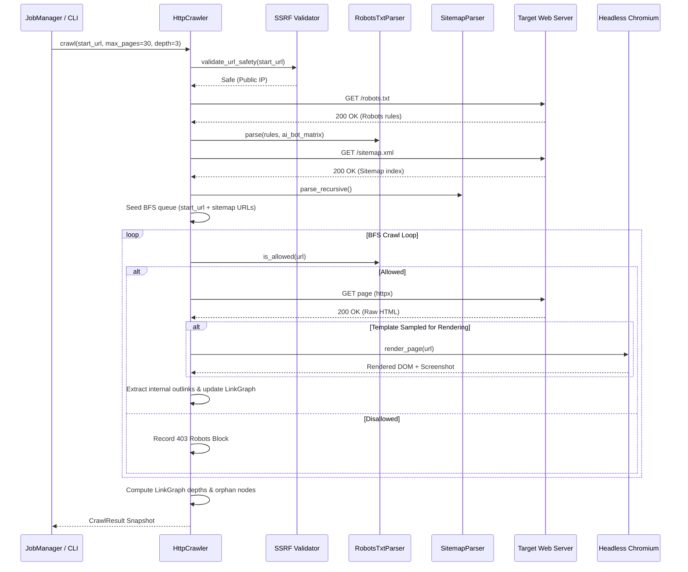

# AuditIQ Architecture & System Design Specification

This document provides a complete technical walkthrough of the **AuditIQ** architecture, data flow, component interactions, and execution guarantees.

---

## 1. System Overview & Component Graph

AuditIQ is engineered as a decoupled, multi-tier intelligence pipeline capable of executing deterministic web crawling, selective headless Chromium rendering, multi-engine AI visibility trials, and responsive report generation.



---

## 2. Asynchronous Crawl & Render Pipeline

### The Two-Tier Strategy (ADR 0003)
Most traditional search engines evaluate JavaScript with massive compute clusters. However, AI crawlers (like `GPTBot`, `ClaudeBot`, and `PerplexityBot`) almost exclusively fetch raw HTML payloads to minimize token latency and compute costs.

AuditIQ mirrors this asymmetry through a **two-tier crawl**:
1. **Tier 1 (Raw HTTP, 100% of discovered pages)**: High-speed async `httpx` stream with gzip/brotli compression, HTTP/2 multiplexing, and RFC 9309 robots compliance.
2. **Tier 2 (Headless DOM, sampled templates)**: Renders a sample of distinct page templates (`--render-sample`, default 5) using headless Chromium to compute the exact **Render-vs-Raw differential** (detecting CSR text loss and dynamic JavaScript-hydrated links).

### Crawl Execution Sequence



---

## 3. Pluggable Check Framework

All checks inherit from the abstract base class `BaseCheck` (`src/auditiq/checks/base.py`):

```python
class BaseCheck(ABC):
  id: str  # Immutable code, e.g. "GEO-BOT-ACCESS"
  layer: AuditLayer  # TECHNICAL, CONTENT, GEO_READINESS, LIVE_VISIBILITY
  title: str
  severity: Severity  # CRITICAL, HIGH, MEDIUM, LOW, INFO
  effort: Effort  # S, M, L
  impact: int  # 1 to 5 scale
  why_it_matters: str
  fix_guidance: str
  references: list[str]

  async def run_site(self, context: SiteContext) -> list[Finding]:
    ...

  async def run_page(self, context: PageContext) -> list[Finding]:
    ...
```

### Execution Flow:
1. `CheckRegistry.run_checks()` registers all checks across selected layers.
2. `run_site` executes concurrently across the entire `CrawlResult` (evaluating sitemaps, robots.txt, `/llms.txt`, and site-wide duplicate cannibalization).
3. `run_page` executes concurrently across every individual `PageSnapshot` (evaluating metadata, heading hierarchy, content readability, schema syntax, and render differentials).
4. Results are normalized into immutable `Finding` objects with structured evidence dictionaries.

---

## 4. Live AI Visibility Engine Architecture

The Live Visibility layer simulates real-world user intent queries against generative answer engines to calculate empirical visibility.

### 5-Archetype Intent Generation
Rather than guessing random keywords, `PromptGenerator` extracts brand name, primary page title, and meta descriptions, generating 20–30 queries balanced evenly across 5 intent buckets:
1. **Discovery**: *"What are the top rated [Category] platforms for businesses?"*
2. **Comparison**: *"[Brand] alternatives and competitors"*, *"[Brand] vs top market leaders"*
3. **Problem-Solution**: *"How do companies solve [Category] challenges?"*
4. **How-To**: *"How to get started with [Category] step by step guide"*
5. **Brand Direct**: *"What is [Brand] and what does it do?"*, *"Is [Brand] legitimate?"*

### Statistical Confidence Guarantee
LLMs are stochastic: identical queries yield different outputs across runs. Single-shot prompts produce noisy, unreliable data.
AuditIQ applies the **Wilson Score Interval** formula with 95% confidence ($z=1.95996$):
$$\text{Lower, Upper} = \frac{\hat{p} + \frac{z^2}{2n} \pm z \sqrt{\frac{\hat{p}(1-\hat{p})}{n} + \frac{z^2}{4n^2}}}{1 + \frac{z^2}{n}}$$
Every visibility report explicitly discloses both the empirical proportion and the sample size (e.g. `65.0% [95% CI: 45.2% - 81.3%, n=20]`).

---

## 5. Security & SSRF Defense

AuditIQ protects enterprise networks against Server-Side Request Forgery (SSRF) via `src/auditiq/crawler/ssrf.py`:
- Parses and resolves all hostnames to IPv4/IPv6 addresses via `socket.getaddrinfo()`.
- Verifies that target IPs do not fall into private, loopback, link-local, carrier-grade NAT, or cloud metadata ranges (`169.254.169.254`, `127.0.0.1`, `10.0.0.0/8`, `192.168.0.0/16`, `172.16.0.0/12`).
- Restricts protocols strictly to `http://` and `https://` (blocking `file://`, `ftp://`, `gopher://`).
- Validates redirect target locations before dispatching subsequent requests.

---

## 6. Real-Time Server-Sent Events (SSE) Architecture

When a client launches an audit via `POST /api/v1/audits`:
1. `JobManager` creates an `AuditJob` with a unique deterministic SHA-256 ID and starts an async background task.
2. The client opens an `EventSource` connection to `/api/v1/audits/{id}/stream`.
3. The crawler and check engines dispatch atomic progress updates into an `asyncio.Queue`.
4. The SSE handler yields real-time JSON frames:
   ```json
   data: {"status": "crawling", "progress_pct": 35, "message": "Crawled (7/20): https://example.com/pricing"}
   ```
5. When the audit completes, the queue yields a completion frame and closes the connection cleanly.
