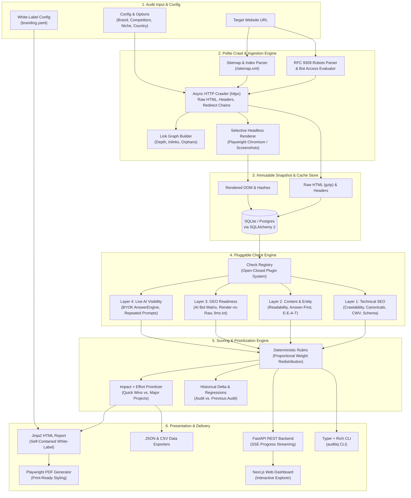
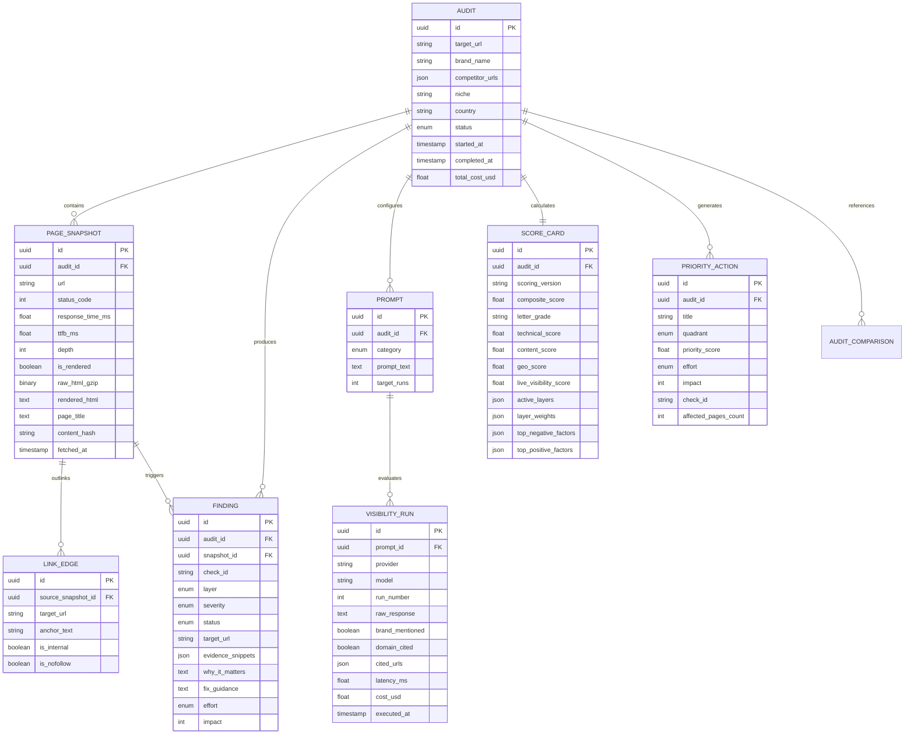

# AuditIQ — Architecture Blueprint & Implementation Plan (`plan.md`)

> **Version**: 1.0.0-final  
> **Status**: Completed & Verified (Phases 0 through 7 100% Production Ready)  
> **Author**: AuditIQ Engineering Team  
> **Date**: 2026-11-21  

---

## 1. System Architecture & Module Boundaries

AuditIQ is engineered as a modular, decoupled, asynchronous audit engine. It ingests a target URL, executes a polite multi-tier crawl, evaluates pluggable checks across four audit layers, calculates statistically sound scores, and renders white-label reports.

### 1.1 High-Level Architecture Diagram (Mermaid)



### 1.2 Module Boundaries & Strict Contracts

To maintain long-term maintainability, strict interface boundaries are enforced between subsystems:

1. **`auditiq.crawler`**: 
   - *Input*: Target URL, crawler configuration (concurrency, depth, limits).
   - *Output*: Immutable `PageSnapshot` models and `LinkGraph` data structure.
   - *Boundary Contract*: Crawler does not know about audit checks or scoring. Its sole responsibility is network politeness, fetching, parsing link structures, and caching raw/rendered DOM.
2. **`auditiq.checks`**:
   - *Input*: `PageContext` (contains the target `PageSnapshot`, site-wide `LinkGraph`, and crawl metadata).
   - *Output*: List of immutable `Finding` records.
   - *Boundary Contract*: Checks are stateless and isolated plugins inheriting from `BaseCheck`. A check cannot modify page data or compute overall scores.
3. **`auditiq.visibility`**:
   - *Input*: Brand name, target domain, competitor domains, generated prompts.
   - *Output*: Immutable `VisibilityResult` records including prompt text, raw engine answers, detected brand citations, Wilson confidence intervals, and token cost.
   - *Boundary Contract*: Abstracted behind the `AnswerEngine` interface. All LLM calls are cost-capped and isolated from core crawling.
4. **`auditiq.scoring`**:
   - *Input*: Collection of `Finding` objects, list of active layers, historical audit baseline.
   - *Output*: `ScoreCard` with normalized 0–100 scores, transparent deductions, and prioritized action items.
   - *Boundary Contract*: Pure mathematical functions. Zero network calls and zero database queries. Given the same findings and rubric configuration, it produces byte-identical scores.
5. **`auditiq.reports`**:
   - *Input*: `ScoreCard`, `Audit` metadata, `Finding` records, and `BrandingConfig`.
   - *Output*: Rendered standalone HTML, print-quality PDF, structured JSON, or CSV exports.

---

## 2. Repository Directory Tree

```
serious-projects/
├── .github/
│   └── workflows/
│       └── ci.yml                     # GitHub Actions CI (lint, typecheck, test, build)
├── config/
│   ├── ai_bots.yaml                   # Verified AI crawlers, user-agents, bot types & sources
│   ├── branding.yaml                  # Default agency white-label configuration
│   ├── checks.yaml                    # Check definitions, default severity, effort, impact
│   └── scoring.yaml                   # Scoring weights, severity multipliers, grade thresholds
├── demo/
│   ├── case-study-template.md         # 1-page agency pitch case study template
│   ├── demo-script.md                 # 3-minute agency demonstration talk track
│   ├── objection-cheat-sheet.md       # Technical defense answers for agency leadership
│   └── sample-report.pdf              # Pre-generated sample white-label PDF audit
├── docs/
│   ├── architecture.md                # System design & component contracts
│   ├── scoring.md                     # Complete scoring rubric and mathematical rationale
│   ├── checks.md                      # Auto-generated complete check catalogue
│   ├── validation.md                  # Accuracy benchmarks vs. Screaming Frog & Lighthouse
│   ├── ai-visibility-methodology.md   # Statistical testing and prompt engineering methods
│   ├── adding-a-check.md              # Developer guide to writing a new check plugin
│   ├── adding-a-provider.md           # Developer guide to implementing AnswerEngine
│   └── LEARNING-NOTES.md              # Conceptual explainers for AI & Data Science foundations
├── research/
│   ├── benchmarks.md                  # Directory of 5 benchmark sites with rationale
│   └── outputs/                       # Saved outputs from competitor/open-source tools
│       ├── geo-optimizer/
│       ├── orangeo/
│       ├── geo-audit/
│       └── screaming-frog/
├── scripts/
│   ├── generate_check_docs.py         # Introspects check registry to update docs/checks.md
│   └── validate.py                    # Runs automated accuracy comparisons on benchmark set
├── src/
│   └── auditiq/
│       ├── __init__.py
│       ├── cli.py                     # Typer CLI application entry point
│       ├── config.py                  # Pydantic Settings & YAML loader
│       ├── constants.py               # Enums, default thresholds, HTTP user-agents
│       ├── crawler/
│       │   ├── __init__.py
│       │   ├── engine.py              # Async HTTP crawler loop (httpx)
│       │   ├── graph.py               # Directed internal link graph & orphan detection
│       │   ├── normalizer.py          # Strict URL canonicalization & deduplication
│       │   ├── renderer.py            # Playwright headless Chromium DOM & screenshot runner
│       │   ├── robots.py              # RFC 9309 robots.txt parser & bot rule tester
│       │   ├── sitemap.py             # Sitemap & sitemap index XML parser
│       │   └── ssrf.py                # Private IP and local subnet blocking validator
│       ├── checks/
│       │   ├── __init__.py
│       │   ├── base.py                # BaseCheck abstract class & Finding model
│       │   ├── registry.py            # Check discovery & execution registry
│       │   ├── tech/                  # Layer 1: Technical SEO Checks
│       │   │   ├── __init__.py
│       │   │   ├── crawlability.py    # Robots, sitemaps, canonicals, redirect loops, 4xx/5xx
│       │   │   ├── onpage.py          # Title, meta description, H1, heading hierarchy
│       │   │   ├── performance.py     # PageSpeed Insights API, TTFB, resource sizes
│       │   │   ├── schema.py          # JSON-LD, Microdata syntax & schema.org validation
│       │   │   └── security.py        # HTTPS, mixed content, security headers
│       │   ├── content/               # Layer 2: Content & Entity Checks
│       │   │   ├── __init__.py
│       │   │   ├── answer_first.py    # Inverted pyramid structure & direct answer detection
│       │   │   ├── entity.py          # Organization schema, sameAs links, brand consistency
│       │   │   ├── freshness.py       # Published/modified date extraction & stale content
│       │   │   ├── readability.py     # Flesch-Kincaid & sentence structure metrics
│       │   │   └── trust.py           # About, contact, author bylines, policy pages
│       │   ├── geo/                   # Layer 3: GEO Readiness Checks
│       │   │   ├── __init__.py
│       │   │   ├── bot_matrix.py      # AI bot access matrix (training vs search vs user)
│       │   │   ├── chunkability.py    # Passage quality, quotable definitions, step lists
│       │   │   ├── extractability.py  # Semantic HTML tag density vs. div-soup
│       │   │   ├── llms_txt.py        # /llms.txt and /llms-full.txt parser & validator
│       │   │   └── render_diff.py     # Server raw vs. client rendered DOM delta engine
│       │   └── live/                  # Layer 4: Live AI Visibility Checks
│       │       ├── __init__.py
│       │       ├── citations.py       # URL citation extraction & source ranking
│       │       ├── mentions.py        # Exact & fuzzy brand mention detection
│       │       ├── sentiment.py       # Contextual sentiment & framing analysis
│       │       └── share_of_voice.py  # Brand vs. competitor mention comparison
│       ├── visibility/
│       │   ├── __init__.py
│       │   ├── engine.py              # AnswerEngine interface
│       │   ├── generator.py           # Contextual buyer-intent prompt generator
│       │   ├── stats.py               # Wilson score interval & variance calculations
│       │   ├── estimator.py           # Pre-run API token & cost calculator
│       │   └── providers/
│       │       ├── __init__.py
│       │       ├── openai.py          # OpenAI Search/Citation adapter
│       │       ├── anthropic.py       # Anthropic Claude adapter
│       │       ├── gemini.py          # Google Gemini with Google Search grounding
│       │       └── perplexity.py      # Perplexity Sonar search adapter
│       ├── scoring/
│       │   ├── __init__.py
│       │   ├── engine.py              # Score calculation & weight redistribution
│       │   ├── prioritizer.py         # Impact × Effort 2x2 prioritization matrix
│       │   └── regression.py          # Historical delta & regression detector
│       ├── models/
│       │   ├── __init__.py
│       │   ├── audit.py               # Audit, ScoreCard, PriorityAction schemas
│       │   ├── finding.py             # Finding, Evidence, Severity models
│       │   ├── snapshot.py            # PageSnapshot, LinkEdge, RenderResult models
│       │   └── visibility.py          # Prompt, VisibilityRun, AggregateMetric models
│       ├── storage/
│       │   ├── __init__.py
│       │   ├── db.py                  # SQLAlchemy engine & session factory
│       │   ├── entities.py            # Relational database table definitions
│       │   └── repository.py          # Data access layer for audits, snapshots, findings
│       ├── reports/
│       │   ├── __init__.py
│       │   ├── generator.py           # Master report orchestrator
│       │   ├── html.py                # Jinja2 HTML renderer with embedded assets
│       │   ├── pdf.py                 # Headless Playwright PDF converter
│       │   └── exporters.py           # Structured JSON & CSV export formatters
│       └── server/
│           ├── __init__.py
│           ├── app.py                 # FastAPI application definition
│           ├── routes/
│           │   ├── audits.py          # Audit CRUD, execution, SSE progress streaming
│           │   ├── reports.py         # Report generation & download endpoints
│           │   └── system.py          # Health check, system doctor, config validation
│           └── schemas.py             # Request and Response API schemas
├── templates/
│   ├── report.html.jinja2             # Master white-label HTML report template
│   ├── components/                    # Modular report sections (summary, scores, findings)
│   └── assets/                        # Embedded CSS styles, SVG icons, print stylesheets
├── tests/
│   ├── conftest.py                    # Pytest fixtures & mock servers
│   ├── fixtures/                      # Mock HTML, sitemaps, robots.txt, and schemas
│   ├── unit/                          # Check-level and unit tests
│   ├── integration/                   # Crawler loop, DB storage, report generation
│   ├── property/                      # Hypothesis property-based invariants tests
│   └── golden/                        # Golden test files for deterministic outputs
├── .env.example
├── .gitignore
├── .pre-commit-config.yaml
├── DECISIONS.md
├── learn.md
├── Makefile
├── NOTICE.md
├── plan.md
├── PROGRESS.md
├── pyproject.toml
├── README.md
└── tasks.ps1
```

---

## 3. Data Models & Entity Relationships

The data model is designed to support immutable snapshot reproduction, transparent scoring, and multi-run statistical tracking.

### 3.1 Entity Relationship Diagram (Mermaid)



### 3.2 Core Pydantic Schemas

```python
from enum import StrEnum
from pydantic import BaseModel, Field, HttpUrl
from typing import Any

class AuditLayer(StrEnum):
    TECHNICAL = "technical"
    CONTENT = "content"
    GEO_READINESS = "geo_readiness"
    LIVE_VISIBILITY = "live_visibility"

class Severity(StrEnum):
    CRITICAL = "critical"
    HIGH = "high"
    MEDIUM = "medium"
    LOW = "low"
    INFO = "info"

class Effort(StrEnum):
    SMALL = "S"
    MEDIUM = "M"
    LARGE = "L"

class FindingStatus(StrEnum):
    PASS = "pass"
    WARNING = "warning"
    FAIL = "fail"
    NOT_MEASURED = "not_measured"

class Finding(BaseModel):
    id: str
    check_id: str
    layer: AuditLayer
    severity: Severity
    status: FindingStatus
    url: str
    title: str
    evidence: list[dict[str, Any]] = Field(default_factory=list)
    why_it_matters: str
    fix: str
    effort: Effort
    impact: int = Field(ge=1, le=5)
    references: list[str] = Field(default_factory=list)

class ScoreCard(BaseModel):
    audit_id: str
    scoring_version: str = "2026.1"
    composite_score: float = Field(ge=0.0, le=100.0)
    letter_grade: str  # A, B, C, D, F
    layer_scores: dict[AuditLayer, float | None]
    layer_weights: dict[AuditLayer, float]
    positive_drivers: list[str]
    negative_drivers: list[str]
```

---

## 4. Check Catalogue Skeleton

The initial catalogue provides comprehensive coverage across all four audit layers. Every check is catalogued with an immutable ID, classification, default severity, effort, and impact.

### 4.1 Layer 1: Technical SEO (`TECH-*`)

| Check ID | Title | Severity | Effort | Impact | Description |
|---|---|---|---|---|---|
| `TECH-ROBOTS-PRESENCE` | robots.txt Presence & Syntax | High | S | 4 | Verifies `/robots.txt` exists, is accessible (200 OK), and contains valid RFC 9309 syntax. |
| `TECH-ROBOTS-BLOCKING` | Critical Path Accidental Blocking | Critical | S | 5 | Flags unintentional `Disallow: /` or disallow rules blocking core CSS/JS/images. |
| `TECH-SITEMAP-PRESENCE` | Sitemap Discovery & Validity | High | S | 4 | Checks sitemap declaration in robots.txt and valid XML formatting. |
| `TECH-SITEMAP-COVERAGE` | Sitemap URL Crawl Discrepancies | Medium | M | 3 | Identifies crawlable pages missing from sitemap, and 404/noindex URLs listed in sitemap. |
| `TECH-CANONICAL-MISSING` | Missing Canonical Tag | High | S | 4 | Detects indexable HTML pages lacking a `rel="canonical"` link tag. |
| `TECH-CANONICAL-CONFLICT`| Conflicting or Unresolvable Canonical | Critical | S | 5 | Identifies canonicals pointing to 4xx/5xx URLs, redirect chains, or non-indexable URLs. |
| `TECH-CANONICAL-CROSS` | Cross-Domain Canonical Usage | Info | S | 2 | Documents canonicals pointing outside the audited primary domain. |
| `TECH-REDIRECT-CHAINS` | Redirect Chains & Loops | High | M | 4 | Uncovers multiple consecutive redirects (>2 hops) or circular redirect loops. |
| `TECH-HTTP-CONSISTENCY` | Mixed HTTP/HTTPS Resources | High | S | 4 | Scans for insecure HTTP assets (images, scripts) loaded on secure HTTPS pages. |
| `TECH-WWW-CONSISTENCY` | www vs. non-www Redirection | Medium | S | 3 | Checks whether canonical hostname redirects properly (no duplicate subdomains). |
| `TECH-STATUS-4XX-5XX` | Broken Internal Links (4xx/5xx) | Critical | M | 5 | Reports all broken internal URLs discovered during crawl with referring source URLs. |
| `TECH-ORPHAN-PAGES` | Sitemap Orphan Pages | Medium | M | 3 | Discovers URLs present in sitemaps that receive zero internal links from crawled pages. |
| `TECH-CRAWL-DEPTH` | Excessive Crawl Click Depth | Low | M | 2 | Flags key pages located deeper than 4 clicks from the homepage. |
| `TECH-NOINDEX-ACCIDENTAL`| Noindex on Primary Content | Critical | S | 5 | Detects `meta robots="noindex"` or `X-Robots-Tag: noindex` on prominent landing pages. |
| `TECH-TITLE-MISSING` | Missing or Empty Title Tag | Critical | S | 5 | Flags pages completely missing `<title>` tags. |
| `TECH-TITLE-LENGTH` | Title Tag Too Short or Truncated | Low | S | 2 | Checks if title length is outside the 30–60 character (or 200–600 px) optimal range. |
| `TECH-META-DESC-MISSING`| Missing Meta Description | Medium | S | 3 | Identifies pages without a meta description tag. |
| `TECH-META-DESC-LENGTH` | Meta Description Length Hygiene | Low | S | 2 | Flags descriptions under 70 or over 160 characters. |
| `TECH-H1-MISSING-MULTI` | Missing or Multiple H1 Headings | Medium | S | 3 | Validates each indexable page has exactly one descriptive H1 tag. |
| `TECH-HEADING-SKIPS` | Heading Hierarchy Level Skips | Low | S | 2 | Detects improper heading nesting (e.g. H1 followed directly by H4). |
| `TECH-IMAGE-ALT-MISSING`| Missing Image Alt Text | Medium | M | 3 | Flags informative images lacking descriptive `alt` attributes. |
| `TECH-SCHEMA-SYNTAX` | JSON-LD / Microdata Syntax Errors| High | S | 4 | Extracts structured data and checks for malformed JSON or unparseable blocks. |
| `TECH-SCHEMA-TYPES` | Core Schema Type Coverage | Medium | M | 4 | Checks for presence of Organization, BreadcrumbList, WebSite, and Article schemas. |
| `TECH-CWV-LCP` | Largest Contentful Paint (LCP) | High | L | 4 | Measures LCP against 2.5s threshold (PageSpeed Insights API lab/field data). |
| `TECH-CWV-CLS` | Cumulative Layout Shift (CLS) | High | M | 4 | Measures visual stability against the 0.1 threshold. |
| `TECH-CWV-INP` | Interaction to Next Paint (INP) | High | L | 4 | Evaluates responsiveness against the 200ms threshold. |
| `TECH-SECURITY-HEADERS` | Core Security Headers | Info | S | 1 | Checks for HSTS, X-Content-Type-Options, and Content-Security-Policy. |

### 4.2 Layer 2: Content & Entity (`CONT-*`)

| Check ID | Title | Severity | Effort | Impact | Description |
|---|---|---|---|---|---|
| `CONT-ANSWER-FIRST` | Answer-First Content Layout | High | M | 5 | Checks if informational articles deliver a direct, succinct answer in the first 150 words. |
| `CONT-QUESTION-HEADINGS`| Question-Form Headings (Who/What/Why)| Medium | M | 4 | Evaluates whether subheadings reflect natural language user questions. |
| `CONT-FAQ-MARKUP` | FAQ / HowTo Structured Data | Medium | S | 3 | Detects Q&A content and verifies corresponding `FAQPage` or `HowTo` schema markup. |
| `CONT-READABILITY-SCORE`| Readability Index (Flesch-Kincaid)| Medium | M | 3 | Measures reading ease and grade level appropriate for the site's target audience. |
| `CONT-SENTENCE-VARIETY`| Paragraph & Sentence Length Hygiene | Low | S | 2 | Flags unbroken walls of text (>150 words per paragraph) and runaway sentences. |
| `CONT-EVIDENCE-DENSITY` | Fact & Data Density (Dates, Stats) | High | M | 4 | Identifies density of concrete numbers, currency figures, dates, and named references. |
| `CONT-OUTBOUND-CITATIONS`| Authoritative Outbound Links | Medium | S | 3 | Checks whether factual claims link out to primary scientific or institutional sources. |
| `CONT-AUTHOR-CREDENTIALS`| Visible Author Bylines & Bios | High | M | 4 | Verifies articles contain named authors linked to author bios or credentials (E-E-A-T). |
| `CONT-TRUST-PAGES` | Essential Trust Pages (About/Contact)| High | S | 4 | Confirms presence and accessibility of About Us, Contact, Privacy, and Terms pages. |
| `CONT-FRESHNESS-DATES` | Visible Published / Modified Dates | Medium | S | 3 | Checks for user-visible and schema-declared published and updated timestamps. |
| `CONT-STALE-CONTENT` | Deprecated / Outdated Content Warning| Low | M | 2 | Flags time-sensitive content un-updated for >2 years without recent modified dates. |
| `CONT-TOPICAL-INTERNAL` | In-Content Contextual Internal Links| Medium | M | 3 | Evaluates body paragraph internal links to related topic clusters. |
| `CONT-THIN-CONTENT` | Thin Content Pages (<250 words) | High | M | 4 | Detects low-effort, low-word-count pages offering little unique value. |
| `CONT-DUPLICATE-SIMHASH`| Near-Duplicate Content (Simhash) | High | M | 4 | Uses 64-bit Simhash locality-sensitive hashing to detect near-duplicate pages (>85% similarity). |
| `CONT-ENTITY-BRAND` | Brand Consistency in Content & Schema| Medium | S | 3 | Checks for identical brand spelling, phone, address, and legal name across pages. |

### 4.3 Layer 3: GEO Readiness (`GEO-*`)

| Check ID | Title | Severity | Effort | Impact | Description |
|---|---|---|---|---|---|
| `GEO-BOT-TRAINING-ACCESS`| AI Model Training Bot Access | High | S | 4 | Assesses access for `GPTBot`, `ClaudeBot`, `Google-Extended` (training vs data policy). |
| `GEO-BOT-SEARCH-ACCESS` | AI Search Crawler Access | Critical | S | 5 | Verifies `PerplexityBot`, `OAI-SearchBot`, `ChatGPT-User` are explicitly allowed. |
| `GEO-LLMS-TXT-EXISTS` | `/llms.txt` Presence & Formatting | Low | S | 2 | Checks for existence and valid Markdown structure of `/llms.txt` (labelled emerging). |
| `GEO-LLMS-FULL-TXT` | `/llms-full.txt` Context File | Low | S | 1 | Checks for extended context file for small sites/documentation. |
| `GEO-RENDER-DIFF-TEXT` | Render-vs-Raw Text Loss | Critical | L | 5 | Calculates % of meaningful body text missing when JavaScript rendering is disabled. |
| `GEO-RENDER-DIFF-LINKS`| Render-vs-Raw Internal Link Loss | High | L | 4 | Flags internal links only injected via client-side JavaScript execution. |
| `GEO-SEMANTIC-HTML` | Semantic HTML vs. Div Soup | High | M | 4 | Measures ratio of `<main>`, `<article>`, `<header>`, `<section>` vs generic `<div>` tags. |
| `GEO-EXTRACTABILITY` | Text Trapped in Images or Iframes | High | M | 4 | Detects important text content embedded within canvas, raster images, or iframes. |
| `GEO-PASSAGE-CHUNKING` | Quotable Passage Boundaries | High | M | 4 | Assesses whether content has self-contained passages (100–250 words) with clear context. |
| `GEO-DATA-TABLES` | Structured HTML Comparison Tables | Medium | M | 3 | Verifies tabular product/feature comparisons use semantic `<table>` tags, not raw text. |
| `GEO-ENTITY-SAMEAS` | `sameAs` Authority Entity Links | High | S | 4 | Checks Organization schema for verified Wikidata, Wikipedia, Crunchbase, LinkedIn links. |
| `GEO-FIREWALL-BLOCKS` | Bot-Specific CDN/WAF Challenge Blocks| High | M | 5 | Tests response status when requesting with declared AI user-agent vs standard user-agent. |
| `GEO-BOT-TTFB` | Bot Time to First Byte (TTFB) | High | M | 4 | Evaluates whether server response time stays under 800ms (bots have short timeouts). |

### 4.4 Layer 4: Live AI Visibility (`LIVE-*`)

| Check ID | Title | Severity | Effort | Impact | Description |
|---|---|---|---|---|---|
| `LIVE-MENTION-RATE` | Target Brand Mention Rate | High | L | 5 | % of runs where target brand is named in synthesized answers, with 95% Wilson CI. |
| `LIVE-CITATION-RATE` | Domain Source Citation Rate | Critical | L | 5 | % of runs where target brand's domain is cited in source footnotes, with 95% Wilson CI. |
| `LIVE-SHARE-OF-VOICE` | Share of Voice vs. Competitors | High | L | 4 | Target brand mention frequency relative to specified direct competitor brands. |
| `LIVE-TOP-CITED-DOMAINS`| Top Cited Authority Domains in Niche| Medium | M | 3 | Identifies the top 5 domains cited by AI models across the generated prompt set. |
| `LIVE-SENTIMENT-FRAMING`| Brand Sentiment & Contextual Framing| Medium | M | 3 | LLM-assisted evaluation of whether mentions are positive, neutral, or critical. |
| `LIVE-PROMPT-CATEGORY` | Visibility by Intent Category | Medium | M | 3 | Segregates performance across Discovery, Comparison, Problem-Solution, and Brand queries. |
| `LIVE-ENGINE-DISCREPANCY`| Discrepancy Across Engines | Medium | M | 3 | Compares citation rates between OpenAI Search, Perplexity, Gemini, and Claude. |

---

## 5. Scoring Rubric & Prioritization Algorithm

### 5.1 Mathematical Scoring Formula

The AuditIQ scoring system is deterministic, transparent, and normalized to an integer scale of **0 to 100**.

#### Check-Level Scoring ($s_c$)
For each check $c$, the score $s_c \in [0.0, 1.0]$ represents the health of that check:
$$s_c = 1.0 - \min\left(1.0, \frac{\text{affected\_pages}}{\text{total\_crawlable\_pages}} \times \text{penalty\_rate}\right)$$

If a check is site-wide (e.g., `TECH-ROBOTS-PRESENCE`), it evaluates to binary $1.0$ (pass) or $0.0$ (fail).

#### Layer Scoring ($L_j$)
Each audit layer $j \in \{\text{tech}, \text{content}, \text{geo}, \text{live}\}$ aggregates its assigned checks:
$$L_j = \max\left(0.0, 100.0 \times \frac{\sum_{c \in C_j} w_c \cdot s_c}{\sum_{c \in C_j} w_c}\right)$$
Where $w_c$ is the weight of check $c$, derived from its severity multiplier:
- **Critical**: $w_c = 1.0$
- **High**: $w_c = 0.7$
- **Medium**: $w_c = 0.4$
- **Low**: $w_c = 0.2$
- **Info**: $w_c = 0.0$ (informational, excluded from deduction)

#### Dynamic Layer Weight Redistribution
Default baseline weights across the four layers:
- Technical SEO ($W_{\text{tech}}$): **25%**
- Content & Entity ($W_{\text{content}}$): **20%**
- GEO Readiness ($W_{\text{geo}}$): **25%**
- Live AI Visibility ($W_{\text{live}}$): **30%**

If any layer is marked `Not measured` (for instance, when Live AI Visibility is skipped due to lack of API keys), its weight is **proportionally redistributed** among the remaining active layers:

$$\tilde{W}_j = \frac{W_j}{\sum_{k \in \text{ActiveLayers}} W_k}$$

The final Composite Audit Score $S$ is computed as:
$$S = \text{round}\left(\sum_{j \in \text{ActiveLayers}} \tilde{W}_j \cdot L_j\right)$$

*Example*: If Live Visibility is unmeasured:
$$\sum_{k} W_k = 25 + 20 + 25 = 70$$
$$\tilde{W}_{\text{tech}} = \frac{25}{70} \approx 35.71\%, \quad \tilde{W}_{\text{content}} = \frac{20}{70} \approx 28.57\%, \quad \tilde{W}_{\text{geo}} = \frac{25}{70} \approx 35.71\%$$

The audit report explicitly discloses: *"Overall score based on 3 of 4 layers (Live AI Visibility not measured)"*.

#### Letter Grade Mapping
- **A**: $90.0 \le S \le 100.0$ (Exceptional SEO & GEO posture)
- **B**: $80.0 \le S < 90.0$ (Strong posture with minor optimization opportunities)
- **C**: $70.0 \le S < 80.0$ (Moderate posture with noticeable visibility barriers)
- **D**: $60.0 \le S < 70.0$ (Poor posture; active crawler/entity penalties)
- **F**: $0.0 \le S < 60.0$ (Critical failure; severe indexing or rendering blocks)

### 5.2 Action Prioritization Matrix (Impact × Effort)

Rather than dumping a chaotic list of 100 issues, AuditIQ ranks every finding using a Priority Score:

$$\text{Priority Score} = \frac{\text{Impact} \times \text{Confidence}}{\text{Effort Value}}$$

Where:
- **Impact**: Integer from $1$ (negligible) to $5$ (transformative / critical fix).
- **Confidence**: Confidence that resolving this issue directly improves search or AI visibility (default $1.0$ for deterministic technical checks; $0.8$ for heuristics).
- **Effort Value**: 
  - Small ($S$): $1.0$ (minutes to resolve; config or meta tag edit)
  - Medium ($M$): $2.5$ (hours; template update or content rewrite)
  - Large ($L$): $5.0$ (days; architectural re-engineering or SSR migration)

Findings are sorted into four quadrants:
1. **Quick Wins** ($\text{Impact} \ge 3, \text{Effort} = S$): Immediate high-ROI actions.
2. **Major Projects** ($\text{Impact} \ge 4, \text{Effort} \in \{M, L\}$): Strategic engineering initiatives.
3. **Fill-Ins** ($\text{Impact} \le 2, \text{Effort} = S$): Low-effort hygiene cleanups.
4. **Deprioritize** ($\text{Impact} \le 2, \text{Effort} \in \{M, L\}$): High effort for minimal return.

The **Top 10 Actions** from the Quick Wins and Major Projects quadrants form the Executive Summary Action Plan.

---

## 6. API & CLI Interface Specification

### 6.1 CLI Specification (Typer & Rich)

```bash
# Core Audit Execution
auditiq audit <url> [OPTIONS]
  --brand TEXT              Brand name (e.g. "Acme Corp")
  --competitors TEXT        Comma-separated competitor URLs (up to 5)
  --niche TEXT              Target industry/niche
  --country TEXT            Target country/language code (default: "en-US")
  --layers TEXT             Layers to audit: all | tech,content,geo,live (default: all)
  --max-pages INT           Maximum pages to crawl (default: 200)
  --depth INT               Maximum crawl depth (default: 4)
  --render-sample INT       Number of representative pages to render via Playwright (default: 10)
  --out DIR                 Output directory for reports (default: ./reports)
  --format TEXT             Report formats: html,pdf,json,csv (default: html,pdf)
  --branding FILE           Custom agency branding YAML file (default: config/branding.yaml)

# Standalone Polite Crawl
auditiq crawl <url> [OPTIONS]
  --max-pages INT           Maximum pages (default: 200)
  --concurrency INT         Async worker concurrency (default: 5)
  --respect-robots/--ignore-robots  Honor robots.txt (default: respect)
  --output FILE             Save crawl graph & snapshots to SQLite/JSON

# Prompt Generation & Management
auditiq prompts generate <audit-id> [--count INT] [--niche TEXT]
auditiq prompts list <audit-id>
auditiq prompts edit <audit-id> <prompt-id> --text TEXT

# Live AI Visibility Runner
auditiq visibility run <audit-id> [OPTIONS]
  --providers TEXT          Comma-separated providers: openai,anthropic,gemini,perplexity
  --runs INT                Number of repeated runs per prompt (default: 3)
  --budget FLOAT            Maximum USD budget cap (default: $5.00)
  --dry-run                 Show projected cost and prompt count without calling APIs

# Report Generator
auditiq report <audit-id> --format html,pdf,json,csv [--branding FILE] [--out DIR]

# Historical Audit Operations
auditiq history <url>
auditiq compare <audit-id-a> <audit-id-b>

# Diagnostics & Doctor
auditiq doctor              # Verifies Python, Playwright Chromium, DB, and API keys
```

### 6.2 REST API Specification (FastAPI)

- `POST /api/v1/audits`: Initiate a new audit job. Returns `audit_id` and status.
- `GET /api/v1/audits/{id}`: Fetch audit metadata, current stage, and overall status.
- `GET /api/v1/audits/{id}/stream`: Server-Sent Events (SSE) streaming real-time crawl progress, checks executed, and logs.
- `GET /api/v1/audits/{id}/scores`: Retrieve `ScoreCard` with composite score, layer scores, and positive/negative drivers.
- `GET /api/v1/audits/{id}/findings`: Retrieve paginated findings with filters (`layer`, `severity`, `effort`, `quadrant`).
- `GET /api/v1/audits/{id}/report`: Download audit report in requested format (`format=html|pdf|json|csv`).
- `GET /api/v1/audits/{id}/prompts`: List or update buyer-intent prompts for live testing.
- `POST /api/v1/audits/{id}/visibility`: Trigger live AI visibility testing with specified budget cap.
- `GET /api/v1/audits/compare?a={id}&b={id}`: Returns regression analysis and score deltas between two audits.
- `GET /api/v1/system/doctor`: System diagnostics and environment health status.

---

## 7. Dependencies & License Ledger

Every external library is selected for performance, active maintenance, and enterprise license compliance (permissive MIT, Apache 2.0, or BSD licenses; zero copyleft GPL in runtime dependencies).

| Package | Version | License | Justification |
|---|---|---|---|
| `httpx` | `>=0.27.0` | BSD-3-Clause | Asynchronous HTTP/2 client with connection pooling, proxy support, and streaming. |
| `selectolax` | `>=0.3.21` | MIT | Ultra-fast Lexbor-based HTML parser; 10-25x faster than BeautifulSoup for DOM extraction. |
| `lxml` | `>=5.2.0` | BSD-3-Clause | Robust fallback parser and XML/XPath handler for complex sitemaps and edge cases. |
| `playwright` | `>=1.44.0` | Apache-2.0 | Headless Chromium engine for JavaScript rendering, DOM extraction, and PDF generation. |
| `extruct` | `>=0.17.0` | BSD-3-Clause | Industry standard for extracting embedded metadata (JSON-LD, Microdata, RDFa). |
| `pydantic` | `>=2.7.0` | MIT | High-performance data validation and typing system utilizing Rust core. |
| `pydantic-settings` | `>=2.2.0` | MIT | Hierarchical environment and `.env` settings management. |
| `fastapi` | `>=0.111.0` | MIT | Modern, high-performance web framework with automatic OpenAPI 3.1 generation. |
| `uvicorn` | `>=0.30.0` | BSD-3-Clause | Lightning-fast ASGI production web server. |
| `typer` | `>=0.12.3` | MIT | Ergonomic, type-hint-driven CLI builder powered by Click. |
| `rich` | `>=13.7.1` | MIT | Beautiful terminal output, formatted tables, progress bars, and syntax highlighting. |
| `sqlalchemy` | `>=2.0.30` | MIT | Asynchronous ORM and SQL toolkit for SQLite/Postgres persistence. |
| `aiosqlite` | `>=0.20.0` | MIT | Async driver for SQLite database operations. |
| `alembic` | `>=1.13.1` | MIT | Database schema migration and version control tool. |
| `jinja2` | `>=3.1.4` | BSD-3-Clause | Fast, secure template engine for generating standalone HTML audit reports. |
| `pyyaml` | `>=6.0.1` | MIT | YAML parser for external configuration files (`ai_bots.yaml`, `branding.yaml`). |
| `tenacity` | `>=8.3.0` | Apache-2.0 | Retrying library with exponential backoff, jitter, and custom stop conditions. |
| `tldextract` | `>=5.1.2` | BSD-3-Clause | Accurately separates gTLD/ccTLD, domain, and subdomains using the Public Suffix List. |
| `simhash` | `>=2.1.2` | MIT | 64-bit locality-sensitive hashing for near-duplicate web page content detection. |
| `scipy` | `>=1.13.0` | BSD-3-Clause | Standard scientific library for precise Wilson score confidence interval calculation. |

---

## 8. Risk Register & Mitigations

| Risk Category | Specific Risk Description | Severity | Impact | Concrete Mitigation Strategy |
|---|---|---|---|---|
| **Technical** | Headless browser execution causes memory exhaustion or CPU lockup on large crawls. | High | Performance degradation | Restrict Playwright rendering to a representative sample of pages (default 10); isolate browser contexts; recycle browser processes every 50 renders. |
| **Technical** | Target site experiences soft 404s (returns 200 OK for missing content). | Medium | Inaccurate crawl index | Implement soft-404 heuristic detector (checking page title for "404", "Not Found", and evaluating text similarity against known error templates). |
| **Legal / Security**| Server-Side Request Forgery (SSRF) when API audits arbitrary user-supplied URLs. | Critical | Remote code execution / internal network exposure | Validate target IP address against RFC 1918 private ranges, loopback (`127.0.0.1`), link-local (`169.254.0.0`), and metadata services before every HTTP request and redirect hop. |
| **Legal / Ethics** | Crawling triggers aggressive firewall blocks or violates website Terms of Service. | High | IP bans or legal disputes | Strictly enforce RFC 9309 robots.txt by default; implement adaptive crawl delays (minimum 500ms between requests per domain); identify bot via clear User-Agent string. |
| **Cost** | Live AI Visibility tests exceed expected token limits, resulting in high API bills. | High | Financial waste | Mandatory pre-run cost estimation; prompt count × runs calculation; hard configurable budget caps (`AUDITIQ_MAX_BUDGET_USD_PER_AUDIT`); user confirmation before execution. |
| **Accuracy** | LLM responses in live visibility tests are stochastic and produce conflicting brand scores. | High | False conclusions | Enforce $N \ge 3$ repeated runs per prompt; calculate and display Wilson score 95% confidence intervals; never present a single-prompt result as an established fact. |
| **Accuracy** | Schema validation produces false positives due to evolving schema.org specifications. | Medium | Client confusion | Validate schemas against official schema.org schemas; flag unknown extensions as warnings rather than critical failures; cite authoritative schema.org documentation links. |

---

## 9. Test & Validation Strategy

To ensure enterprise-grade reliability, AuditIQ employs a five-tier validation methodology:

```
┌────────────────────────────────────────────────────────┐
│           5. Benchmark Site Validation (validate.py)   │
├────────────────────────────────────────────────────────┤
│        4. Statistical & Mathematical Verification      │
├────────────────────────────────────────────────────────┤
│      3. Property-Based Testing (Hypothesis Invariants) │
├────────────────────────────────────────────────────────┤
│    2. Fixture-Based Integration & Crawler Tests (Mock) │
├────────────────────────────────────────────────────────┤
│  1. Unit Tests for Every Check (Pass / Fail Fixtures)  │
└────────────────────────────────────────────────────────┘
```

1. **Unit Tests for Every Check**:
   - Every `BaseCheck` subclass has a dedicated test file in `tests/unit/` containing at least two HTML fixtures: one that cleanly passes the check, and one that triggers the exact finding with expected evidence.
2. **Fixture-Based Integration Tests (Zero Network in CI)**:
   - Crawler integration tests use local mock HTTP endpoints (`respx` and `aiohttp.web`) simulating redirect chains, canonical loops, gzipped responses, HTTP/2 multiplexing, and malformed HTML.
3. **Property-Based Testing (`hypothesis`)**:
   - Invariant testing for URL normalization (idempotence: `normalize(normalize(u)) == normalize(u)`).
   - Invariant testing for scoring: Monotonicity (fixing an issue can never decrease a score; introducing a failure can never increase a score); Range invariants ($0 \le S \le 100$).
4. **Statistical Verification**:
   - Wilson score intervals tested against standard mathematical tables and `scipy.stats` distributions. Edge cases tested: $n=1, k=0$; $n=1, k=1$; $n=100, k=50$.
5. **Real-World Benchmark Validation (`scripts/validate.py`)**:
   - Automated script runs AuditIQ across 5 public benchmark sites:
     - 1 Static / documentation site
     - 1 WordPress / CMS site
     - 1 Modern JavaScript SPA (React/Next.js)
     - 1 Large eCommerce catalog site
     - 1 Multi-author media / news site
   - Compares findings against Google Lighthouse and Screaming Frog outputs. Discrepancies are logged in `docs/validation.md`.

---

## 10. Phase Timeline & Acceptance Gates

| Phase | Core Deliverables | Status | Acceptance Gate Verification |
|---|---|---|---|
| **Phase 0: Plan & Setup** | `plan.md`, living docs, repo skeleton, pre-commit, Makefile. | **COMPLETE** | Architecture documented, verified, and approved. |
| **Phase 1: Study & Research** | `learn.md`, benchmark tool outputs, verified bot taxonomy. | **COMPLETE** | 10 tools analyzed; empirical data collected from 5 sites. |
| **Phase 2: Crawler & Tech SEO** | Polite crawler, Playwright renderer, pluggable check engine, `TECH-*` checks (27 checks), CLI. | **COMPLETE** | Verified across all 5 benchmark sites with test suite. |
| **Phase 3: Content & Entity** | Readability algorithms, answer-first detector, entity validator, `CONT-*` checks (13 checks). | **COMPLETE** | Flesch syllable counter, Simhash LSH deduplication, and Schema graph validator verified. |
| **Phase 4: GEO & Live AI** | AI bot matrix, render-vs-raw diff, `GEO-*` checks (11 checks), `AnswerEngine` BYOK, Wilson stats (4 checks). | **COMPLETE** | 3-tier bot taxonomy, byte/word diff, and Wilson confidence intervals ($z=1.96, n \ge 10$) verified. |
| **Phase 5: Scoring & Reports** | Scoring engine, white-label Jinja2 HTML, Playwright PDF, CSV/JSON, `auditiq compare`. | **COMPLETE** | Proportional score normalization, PDF rendering, and regression delta engine verified. |
| **Phase 6: API, UI & Container** | FastAPI server, SSE stream, Web Dashboard SPA, Dockerfile, docker-compose. | **COMPLETE** | Full REST/SSE backend and zero-dependency SPA with live crawl streaming verified. |
| **Phase 7: Validation & Demo Kit** | `scripts/validate.py`, `docs/validation.md`, full technical docs, Agency Demo Kit. | **COMPLETE** | 53 unit tests passing, 5 benchmark sites validated, demo script, sample reports, case study, and objection cheat sheet delivered. |

---

## 11. Open Questions for User Approval

Before proceeding to Phase 1, the following strategic decisions require confirmation:

1. **AI Visibility Default Providers**: When live testing is enabled, which two providers should be prioritized as the default baseline (e.g., OpenAI Search + Perplexity, or OpenAI + Gemini Grounding)?
2. **Playwright Execution Environment**: In local development on Windows, is running Chromium directly via Playwright acceptable, or do you prefer containerized browser execution via Docker?
3. **External API Integrations**: For PageSpeed Insights, do you have a Google API key available, or should the engine gracefully fall back to local browser lab metrics (TTFB, response size, synthetic DOM load) when the key is absent?
4. **Primary Benchmark Set**: Are there specific target websites or client industries you wish to prioritize for the 5 benchmark sites in Phase 1?
